# roll-call

A Claude Code mod for people who run several sessions at once. Type `/board` in one window and it lists your other sessions above the prompt: which ones are waiting for you, which are still working, and on what.



<sub>An illustration, not a recording: the rows are the mod's own output for four made-up sessions, drawn as it draws them.</sub>

It draws nothing until you ask. Only the window you typed `/board` in shows the board; the rest stay as they were.

## Install

Claude Code 2.1.287 or later.

```
/plugin marketplace add dim-owl/roll-call
/plugin install roll-call@roll-call
/reload-plugins
```

Or from a terminal:

```sh
claude plugin marketplace add dim-owl/roll-call
claude plugin install roll-call@roll-call
```

Sessions that were already open pick the mod up after `/reload-plugins`. A session shows on the board only if the mod is loaded in it.

To update: `claude plugin marketplace update roll-call`, then `claude plugin update roll-call@roll-call`, then `/reload-plugins`. An install is a copy, so nothing changes until you update. To remove: `claude plugin uninstall roll-call@roll-call`, and delete the `roll-call` folder under your Claude Code folder.

## Use

| Command | Does |
| --- | --- |
| `/board` | show the board above this window's prompt |
| `/board` again | hide it |

## What a row says

```
 ask     api-review    Should the default stay on?                              4m
 done    docs          Rewrote the install section; nothing left to do.         now
 work    migration     agents 3  shell 1  final-gate ████████░░ 14/18 · 6m  move the billing tables   12m
 wait    frontend      → api-review · sent the merge request
```

| Word | Means | Beside it |
| --- | --- | --- |
| `ask` | it asked you a question | the question |
| `approve` | a tool call is waiting for your permission | the tool, and the program, file or host it is for |
| `error` | its turn broke off on an API error | why (usage limit, overloaded, ...) |
| `done` | its turn ended | the first line of its answer |
| `work` | it is working | what you last asked of it |
| `wait` | it sent a message to another session and stopped | which session |
| `idle` | nothing asked yet | where it runs |

The time at the end of a row is how long that session has waited for you, or, for one at work, how long since you gave it the task.

**Colour has one meaning each.**

- A coloured background (yellow `ask`, `approve`, `error`; green `done`) means the session is calling for you. Green fades after five minutes; the row stays.
- Orange text (`work`) means it is running.
- Grey means there is nothing for you to do.

A working session also shows what it has running: `agents 3` (its subagents), `shell 2` (background shells), `monitor 1`, and a bar for each workflow run with agents finished over agents started. A session whose turn ended while any of that still runs reads as `work`, not `done`: it will wake by itself.

## What it reads and writes

The mod only watches. Every hook passes its event on unchanged; it never denies, rewrites or delays a tool call or a prompt.

Each session writes one small file, `<Claude Code folder>/roll-call/<session id>.json`, and the board reads the files of the others (a text read from another session's file has its control characters taken out before it is drawn). A file holds:

- the session's name (from `/rename`), the folder it works in and its git branch
- how it stands, and since when
- **the first line of your last prompt** (up to 160 characters) and **the first line of the session's last answer**
- for a permission wait: the tool's name and the program, file name or host it is for. Never the whole command or address, since either may carry a secret
- counts of what it has running, and the names of its workflow runs

Know this before installing: your prompts' first lines are kept on disk in that folder, and shown in any window where the board is on. If you share your screen, the board shares them too.

Files of sessions that ended stay behind (the mod API has no way to delete a file). They are skipped when read. Delete the `roll-call` folder whenever you like.

It reads, and never writes, the files Claude Code itself keeps of its sessions (`<Claude Code folder>/sessions/<pid>.json`), for one thing: the name you gave this session. Those files are not a documented interface; if a release changes them, a session goes by its folder until the mod catches up. It also runs `git` in the session's folder (`rev-parse`, twice). It makes **no** network requests and calls no model. `claude plugin validate .` prints exactly what it hooks and calls.

## Configure

In `/config`, or under `pluginConfigs` in `settings.json`:

| Option | Default | Meaning |
| --- | --- | --- |
| `language` | `en` | the language of the board's own words: `en` or `ko` |

## What is counted, not known

- **A workflow's bar is agents finished over agents started so far.** A workflow starts agents as it goes, so the right-hand number is not the total and the bar can step back when a new phase begins.
- **A workflow's own agents are not in `agents N`.** They show only in the bar.
- **`monitor N` counts the monitors the session started itself.** Claude Code files other things under the same name (the watch left by a published artifact, for one), and those never end, so they are left out.
- **A short answer is not a new task.** "ok", "yes, go on", "continue" leave the last task standing on the row.
- **Two things have not been seen live**, only in tests: `error` (built from the documented event for a turn that ends on an API error; nobody has hit a usage limit with the board open yet), and going on after an in-session `/resume` or `/clear` under the new session id. If either misbehaves, please open an issue.

## Limits


- Sessions on this machine only, and only those with the mod loaded.
- A session is taken for gone after 90 seconds without a write. The board refreshes every 5 seconds.
- Reloading the mod while a workflow runs loses that run's count: its bar is gone, and the run shows as `workflow 1` from the session's next turn end.
- Mods are an early-access Claude Code feature and their API can change between releases.

## Develop

```sh
claude --plugin-dir .            # load it; edits hot-reload
claude plugin validate .
claude plugin test .
```

| File | Holds |
| --- | --- |
| [`hooks/register.tsx`](hooks/register.tsx) | the hooks, the file each session writes, and the drawing |
| [`hooks/register.test.ts`](hooks/register.test.ts) | the tests, run against the engine |
| [`types/index.d.ts`](types/index.d.ts) | the shape of a session's file and of the board's state |

## License

[MIT](LICENSE)
